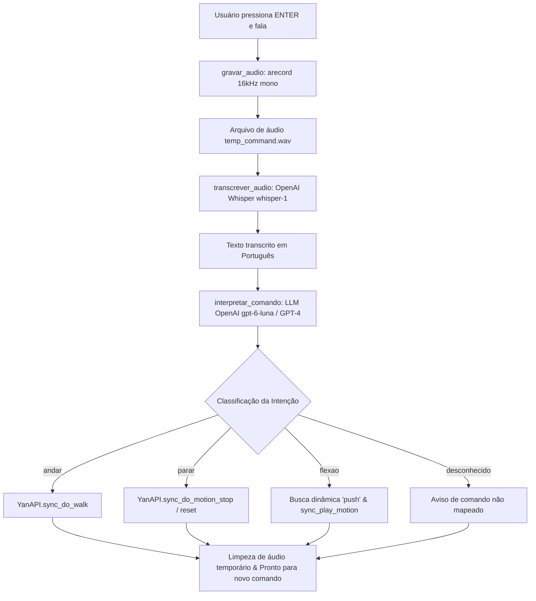

# 🤖 Controle por Voz do Robô Humanóide Yanshee via IA

Este projeto implementa um sistema de controle por voz para o robô humanóide **UBTECH Yanshee**, desenvolvido para a disciplina de Robótica da **UNIFTEC**. A solução combina captura de áudio local, inteligência artificial em nuvem (reconhecimento de fala com **OpenAI Whisper** e interpretação semântica com **LLM**) e controle mecânico em tempo real através da **YanAPI**.

---

## 📋 Sumário

- [Visão Geral](#-visão-geral)
- [Arquitetura e Fluxo de Execução](#-arquitetura-e-fluxo-de-execução)
- [Comandos e Ações Suportadas](#-comandos-e-ações-suportadas)
- [Estrutura do Projeto](#-estrutura-do-projeto)
- [Pré-requisitos](#-pré-requisitos)
- [Instalação e Configuração](#-instalação-e-configuração)
- [Como Executar](#-como-executar)
- [Tratamento de Exceções e Resolução de Problemas](#-tratamento-de-exceções-e-resolução-de-problemas)
- [Tecnologias Utilizadas](#-tecnologias-utilizadas)

---

## 🔍 Visão Geral

O objetivo do sistema é permitir que um usuário dite ordens em linguagem natural em português para o robô Yanshee. Em vez de depender de palavras-chave rígidas, o sistema utiliza um modelo de linguagem para entender a **intenção** do usuário, traduzindo comandos falados variados (como *"por favor, dê alguns passos à frente"* ou *"chega, fique parado"*) em comandos físicos seguros para os servomotores do robô.

O código é otimizado para execução direta no ambiente Linux embarcado (Raspberry Pi) do Yanshee, utilizando sintaxe compatível com Python 3.5+.

---

## 🏗 Arquitetura e Fluxo de Execução

O ciclo de funcionamento segue o seguinte pipeline:



### Funções Principais (`main.py`):

1. **`gravar_audio(output_filename, duracao=4)`**: Executa o utilitário Linux nativo `arecord` via `subprocess`, gravando em formato 16-bit PCM linear mono a 16 kHz (padrão ideal para Whisper).
2. **`transcrever_audio(audio_path)`**: Envia o `.wav` para o endpoint `/v1/audio/transcriptions` da OpenAI usando o modelo `whisper-1` com idioma forçado para português (`pt`).
3. **`interpretar_comando(texto)`**: Envia a transcrição para a API Chat Completions com um prompt restritivo de sistema e `temperature: 0.0`. O modelo responde estritamente com uma das quatro classes: `andar`, `parar`, `flexao` ou `desconhecido`.
4. **`executar_acao_yanshee(acao)`**: Comunica-se com o robô via `YanAPI` para disparar os movimentos correspondentes.
5. **`main()`**: Interface CLI interativa em loop com captura de exceções (`KeyboardInterrupt`), remoção do áudio temporário e redefinição da postura do robô no encerramento.

---

## 🎯 Comandos e Ações Suportadas

Graças ao LLM, o usuário não precisa dizer uma palavra exata, mas sim expressar a ideia:

| Ação Mapeada | Exemplos de Frases | Execução no Yanshee (YanAPI) |
|---|---|---|
| **`andar`** | *"ande para frente"*, *"caminhe"*, *"dê alguns passos"* | `YanAPI.sync_do_walk("forward", 4, "normal")` |
| **`parar`** | *"pare"*, *"fique quieto"*, *"interromper movimento"* | `YanAPI.sync_do_motion_stop()` seguido de `YanAPI.sync_do_motion_reset()` |
| **`flexao`** | *"faça flexões"*, *"exercício no chão"*, *"bora treinar flexão"* | Busca na memória (`get_motion_list_value()`) por animações contendo `push` e executa via `sync_play_motion()` |
| **`desconhecido`** | Frases fora do escopo ou ruídos ininteligíveis | Não executa ações físicas, protegendo o robô |

---

## 📂 Estrutura do Projeto

```text
libertadores_gremio_2017/
├── .env                # Arquivo para variáveis de ambiente locais (ex: OPENAI_API_KEY)
├── .gitignore          # Ignora .env, temp_command.wav e caches Python
├── main.py             # Script principal de controle por voz e integração
└── README.md           # Documentação do projeto
```

---

## ⚙️ Pré-requisitos

### Hardware
- Robô humanoide **UBTECH Yanshee** (com Raspberry Pi interna e placa controladora de servos).
- Microfone conectado e configurado como entrada de áudio padrão (`default`) no Linux ALSA.

### Software
- Sistema Operacional: Linux / Raspbian (nativo do Yanshee).
- Python 3.5 ou superior instalado.
- Pacote `alsa-utils` instalado (fornece o utilitário de gravação `arecord`).
- Biblioteca proprietária **`YanAPI`** instalada no ambiente Python do robô.
- Conexão com a Internet (para requisições à API da OpenAI).

---

## 🚀 Instalação e Configuração

### 1. Clonar o Repositório no Yanshee

Acesse o terminal do robô via SSH:

```bash
git clone https://github.com/GabrielBiasolli/libertadores_gremio_2017.git
cd libertadores_gremio_2017
```

### 2. Instalar Dependências do Python

Instale os pacotes necessários:

```bash
pip3 install -r requirements.txt
```

> **Nota:** O módulo `YanAPI` já vem pré-instalado na imagem oficial do Yanshee. Se estiver testando fora do robô, certifique-se de possuir o SDK da UBTECH configurado.

### 3. Configurar a Chave da OpenAI

O script exige a variável de ambiente `OPENAI_API_KEY`. Defina-a no terminal antes de iniciar:

```bash
export OPENAI_API_KEY="sk-proj-sua-chave-aqui"
```

Alternativamente, é possível definir a variável de forma persistente no `~/.bashrc` do Raspberry Pi.

---

## 🎮 Como Executar

Execute o script com o Python 3:

```bash
python3 main.py
```

### Interagindo pelo Terminal:

1. O terminal exibirá o cabeçalho do programa.
2. Pressione **`[ENTER]`** quando estiver pronto para falar.
3. O terminal indicará `[*] Gravando... Fale o comando agora!`. Fale claramente próximo ao microfone por até 4 segundos.
4. O áudio será transcrito pelo Whisper e interpretado pelo LLM.
5. O robô executará a ação física correspondente.
6. Para encerrar o programa com segurança, digite **`q`** e pressione **`[ENTER]`** (ou pressione `Ctrl+C`). O robô retornará à sua postura de repouso segura (`reset`).

---

## 🛠 Tratamento de Exceções e Resolução de Problemas

- **Erro `Defina a variavel de ambiente OPENAI_API_KEY antes de rodar`**:
  Certifique-se de exportar a variável com `export OPENAI_API_KEY="sua_chave"`.
- **Erro ao gravar áudio via `arecord`**:
  Verifique se o microfone está conectado e reconhecido pelo sistema rodando `arecord -l`.
- **Erro 404 / Modelo LLM indisponível**:
  No arquivo `main.py`, a função `interpretar_comando` está configurada com o modelo `"model": "gpt-6-luna"`. Caso sua conta OpenAI utilize modelos de produção padrão, altere para `"gpt-4o-mini"` ou `"gpt-3.5-turbo"` na linha 86.
- **Movimento de flexão não encontrado**:
  O robô pesquisa na lista de animações internas (`YanAPI.get_motion_list_value()`) por qualquer movimento contendo a palavra `push`. Se o arquivo tiver outro nome (como `push_up` ou `flexao`), a lista de nomes existentes será impressa no terminal para facilitar a conferência.

---

## 🧰 Tecnologias Utilizadas

- **[UBTECH Yanshee & YanAPI](https://www.ubtrobot.com/)**: Plataforma robótica educacional e API de controle de servomotores.
- **[OpenAI Whisper](https://openai.com/research/whisper)**: Reconhecimento automático de fala (ASR).
- **[OpenAI Chat Completions](https://platform.openai.com/docs/api-reference/chat)**: Compreensão de linguagem natural (NLU) e classificação semântica de intenções.
- **[ALSA (Advanced Linux Sound Architecture)](https://www.alsa-project.org/)**: Captura de áudio de baixa latência via `arecord`.
- **Python 3**: Linguagem de orquestração do pipeline.
